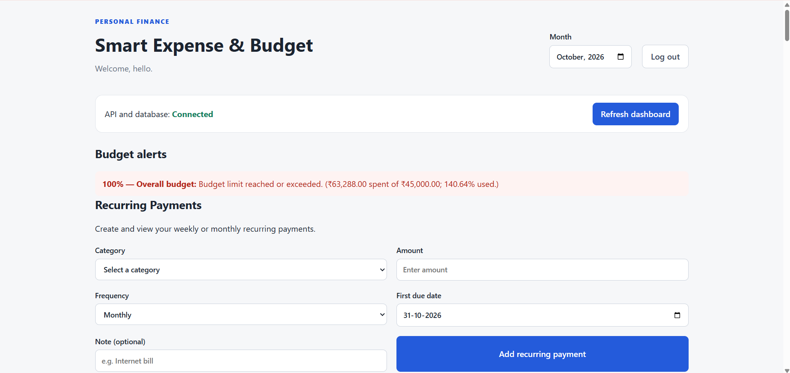
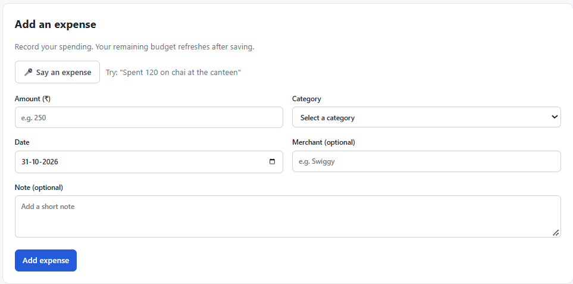
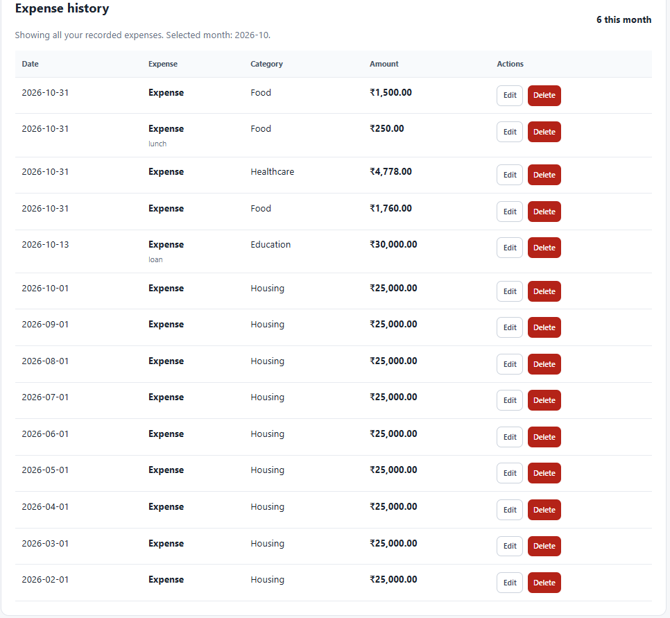

# Usability Testing Report -- Issue #63 (NFR02)

## 1. Objective

The purpose of this usability test was to check whether a first-time
user could add an expense to the application easily, without help. The
target was to complete the task within one minute without assistance.

## 2. Test task

Each participant was given the same task:

> Imagine you spent ₹250 on lunch today. Add this expense to the
> application. Complete this task without anyone helping you.

Participants were not shown where the expense form was or how to use it.
The time was recorded for each attempt.

## 3. Participants and results

Five participants took part in the test. The results recorded for each
participant are shown below.

  -------------------------------------------------------------------------
  Participant          Time taken Expense saved Assistance    Difficulty /
                                                needed        observation
  ------------- ----------------- ------------- ------------- -------------
  Participant 1         7 seconds Yes           No            No difficulty
                                                              reported

  Participant 2        45 seconds Yes           Yes           Initially
                                                              took time to
                                                              understand
                                                              the interface

  Participant 3        32 seconds Yes           No            Initially
                                                              seemed
                                                              unsure, but
                                                              understood
                                                              the interface
                                                              later

  Participant 4        26 seconds Yes           No            No difficulty
                                                              specified

  Participant 5        26 seconds Yes           No            No difficulty
                                                              specified
  -------------------------------------------------------------------------

## 4. Results summary

-   Participants tested: 5
-   Expenses successfully saved: 5 out of 5
-   Average completion time: 27.2 seconds
-   Participants who completed without assistance: 4 out of 5
-   Participants who completed within one minute without assistance: 4
    out of 5 (80%)
-   Participants who needed assistance: 1 out of 5

All five participants saved the expense within one minute. However, one
participant needed assistance, so the target of completing the task
within one minute without help was met by four out of five participants,
not all five.

## 5. Usability issues observed

The feedback suggests that some first-time users may need time to
understand the interface. Participant 2 needed assistance and took time
to understand it. Participant 3 initially seemed unsure but completed
the task without assistance.

No specific difficulty was recorded for Participants 4 and 5. No
additional observations were recorded by the test facilitator.

## 6. Suggested improvements

Based on the difficulties reported, the team should consider:

1.  Making the **Add Expense** section easier to notice when a new user
    opens the dashboard.
2.  Using a clear heading and short instruction near the expense form,
    such as "Add a new expense".
3.  Making required fields and the save action visually clear.
4.  Asking a new user to try the task again after any interface
    improvement, to check whether the confusion has reduced.

These are proposed improvements based on the limited observations
recorded in this test. They have not yet been implemented or retested.
## 7. Actual Screenshots

### Figure 1: Application Dashboard

### Figure 2: Add Expense Form

### Figure 3: Successfully Saved Expense

## 8. Conclusion

The usability test was conducted with five participants. All five
successfully saved the test expense, and the average completion time was
27.2 seconds. Four participants completed the task within one minute
without assistance. One participant needed assistance, and another
participant initially appeared unsure but completed the task
independently.

The one-minute target was therefore achieved by 80% of participants. The
main improvement area identified from the recorded feedback is making
the expense-entry interface easier for first-time users to understand
and locate.

## 9. Evidence

The following screenshots are included as supporting evidence:

Figure 1: Application dashboard used during testing.

Figure 2: Add Expense form presented to participants.

Figure 3: Successfully saved test expense.

The participant timings and observations are documented in Section 3.
